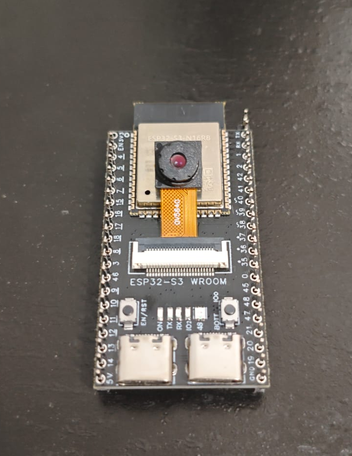
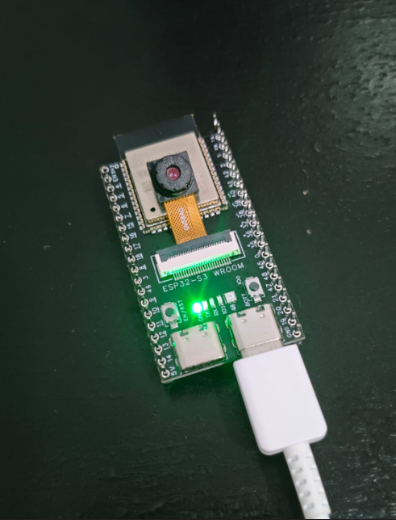
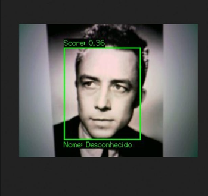
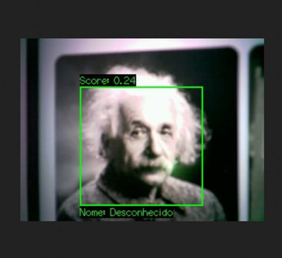
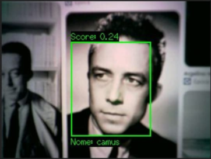
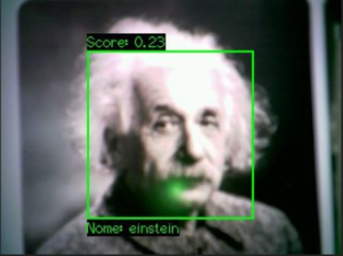
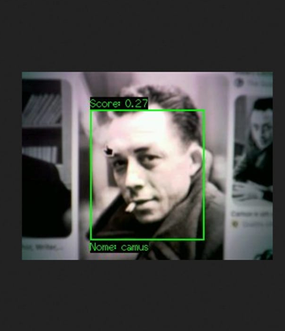
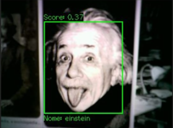

# 🖥️ESP32-S3 Face Recognition & MJPEG Streamer🖥️

Mini-projeto desenvolvido com ESP32-S3-EYE(Usando ESP32-S3-N16R8) focado em visão computacional embarcada, utilizando processamento multinucleado (FreeRTOS), renderização em tempo real via TFT_eSPI e um servidor web integrado para streaming e gerenciamento de identidades.

# Sobre o Projeto / About the Project
## 🇧🇷 Português

O projeto foi desenvolvido primariamente no PlatformIO e tem a capacidade de detectar e identificar diferentes faces em tempo real utilizando uma câmera OV5640 (5MP). As identidades cadastradas são armazenadas na memória RAM do ESP32, portanto os dados não são persistentes após reinicializações.

    Tecnologias e Bibliotecas Principais:

        PlatformIO (com a plataforma espressif32@6.6.0)

        TFT_eSPI (para renderização eficiente de sprites e textos na tela/buffer)

        esp-dl (HumanFaceDetectMSR01 para detecção facial otimizada)

        FreeRTOS (para tarefas concorrentes em múltiplos núcleos: IA no Core 1 e Servidor Web no Core 0)

        ESP HTTP Server (com endpoints para /stream, /register e /logs)

    Precisão e Desempenho:
    O sistema utiliza um cálculo otimizado de sobreposição (IoU - Intersection over Union) para rastreamento e reconhecimento facial. A taxa de acerto é alta sob condições de iluminação e ângulos similares.

## 🇺🇸 English

This project was developed primarily on PlatformIO and features real-time face detection and recognition using an OV camera module. Registered identities are stored directly in the ESP32's RAM, meaning data is not persistent and resets upon reboot.

    Core Stack & Libraries:

        PlatformIO (espressif32@6.6.0)

        TFT_eSPI (high-performance sprite rendering)

        esp-dl (HumanFaceDetectMSR01 face detection)

        FreeRTOS (dual-core concurrency: AI task on Core 1, Web Server on Core 0)

        ESP HTTP Server (endpoints for /stream, /register, and /logs)

# 📸 Demonstração / Demo

## Aqui estão alguns exemplos do sistema em funcionamento (diferenciando rostos como Albert Einstein e Albert Camus através do stream web):

## ESP32-S3-N16R8:

  
  

## antes/before:

  
  

## depois/after:

  
  

  
  

# 🔌 Endpoints do Servidor Web / Web Server Endpoints

Acesse pelo navegador na mesma rede Wi-Fi:

    http://<IP-DO-ESP32>/stream — Transmissão de vídeo em tempo real (MJPEG).

    http://<IP-DO-ESP32>/register?name=SeuNome — Endpoint HTTP para registrar instantaneamente a face detectada.

    http://<IP-DO-ESP32>/logs — Buffer de logs do sistema acessível remotamente.